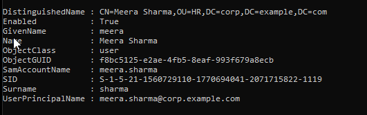
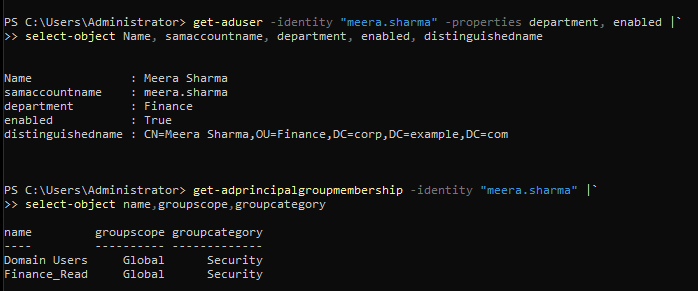
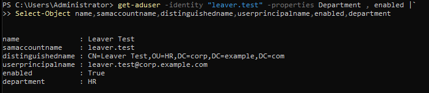
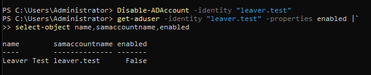
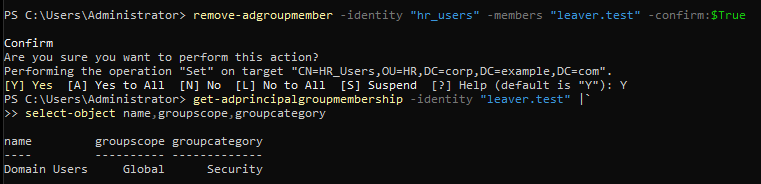
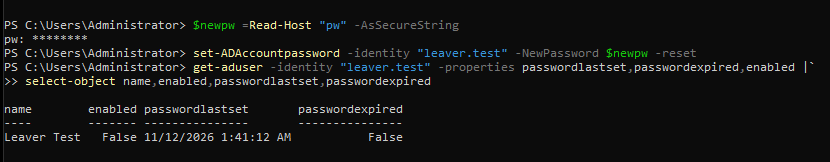
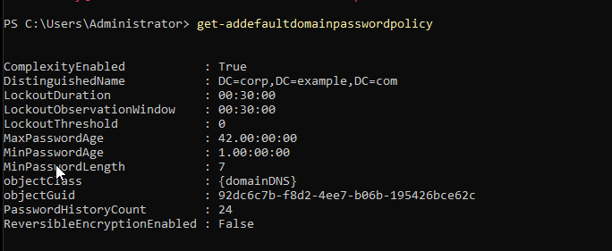
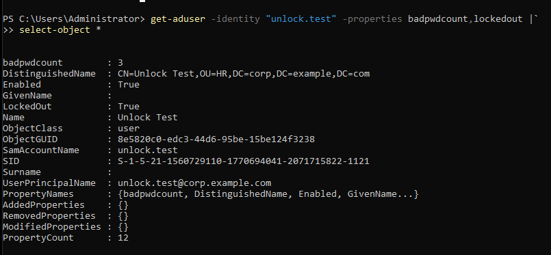
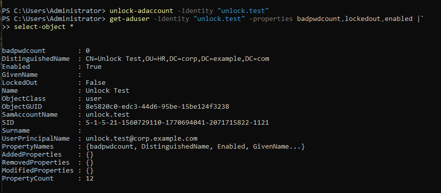
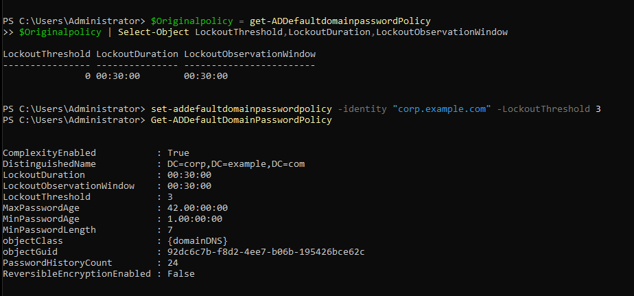

# Active Directory User Lifecycle Management Using PowerShell

## 1. Project Overview

### Objective

The objective of this project is to implement and troubleshoot common Identity and Access Management (IAM) operations using Microsoft Active Directory Domain Services (AD DS) and Windows PowerShell.

A virtual enterprise environment was configured to simulate identity administration tasks commonly performed by IAM Operations, Active Directory Administrators, and IT Helpdesk teams.

The project focuses on managing user identities throughout their lifecycle, controlling group-based access, handling password-related requests, and troubleshooting account lockouts.

### Scope

The following operations were implemented:

1. Joiner – New employee account provisioning.
2. Mover – Department transfer and access modification.
3. Leaver – Employee offboarding and access revocation.
4. Password Management – Administrative password reset.
5. Account Management – Enable and disable accounts.
6. Account Lockout – Investigate failed authentication and unlock accounts.
7. Security Policy – Inspect, temporarily modify, and restore domain lockout policy.

**Implementation approach:** All operations were first performed manually using individual PowerShell cmdlets to understand the underlying AD administration process before introducing automation.

---

## 2. Lab Architecture

### Environment Configuration

| Component | Configuration |
|---|---|
| Domain Controller | DC01 |
| Client Machine | WIN10-CLIENT |
| Server Operating System | Windows Server |
| Client Operating System | Windows 10 Pro |
| Domain Name | corp.example.com |
| NetBIOS Name | CORP |
| Domain Controller IP | 192.168.10.10 |
| Client IP | 192.168.10.20 |
| Virtual Network | IAM-LAB |
| Administration Tool | Windows PowerShell |
| PowerShell Module | ActiveDirectory |

### Lab Design

- DC01 hosts Active Directory Domain Services and DNS.
- WIN10-CLIENT is joined to the `corp.example.com` domain.
- Both virtual machines communicate through the VirtualBox internal network named `IAM-LAB`.
- User accounts, organisational units, and security groups are managed through DC01.
- Client-side authentication is tested from WIN10-CLIENT.

### Active Directory Structure

```text
corp.example.com
│
├── Domain Controllers
│
├── Finance
│   ├── arun.kumar
│   ├── rahul.kumar
│   └── meera.sharma (after transfer)
│
├── HR
│   ├── priya.kumari
│   └── leaver.test (disabled)
│
└── IT
    └── karthik.kumar
```

### Security Groups

| Group | Scope | Category | Purpose |
|---|---|---|---|
| Finance_Read | Global | Security | Read access to Finance resources |
| HR_Users | Global | Security | HR department access |
| IT_Support | Global | Security | IT support access |

### Initial Environment Validation

The AD PowerShell module was checked and imported.

```powershell
Get-Module -ListAvailable ActiveDirectory

Import-Module ActiveDirectory

Get-ADDomain
```

Domain connectivity was checked from the client.

```powershell
$env:LOGONSERVER

whoami

nltest /dsgetdc:corp.example.com
```

The client successfully identified DC01 as its domain controller.

---

## 3. Joiner – New Employee Provisioning

### Business Scenario

A new employee named Meera Sharma joins the HR department.

The IAM administrator receives an approved onboarding request and must create the employee's identity with the appropriate attributes and department access.

### Provisioning Requirements

| Attribute | Required Value |
|---|---|
| Employee Name | Meera Sharma |
| Username | meera.sharma |
| UPN | meera.sharma@corp.example.com |
| Department | HR |
| Target OU | HR |
| Security Group | HR_Users |
| Account Status | Enabled |
| Initial Password | Securely supplied |

### Step 1: Validate Existing Identity and Target Resources

Before creating the account, verify whether the username already exists.

```powershell
Get-ADUser -Filter "SamAccountName -eq 'meera.sharma'"
```

Verify the target OU and security group.

```powershell
Get-ADOrganizationalUnit -Identity "OU=HR,DC=corp,DC=example,DC=com"

Get-ADGroup -Identity "HR_Users"
```

**Why is this necessary?**

- Prevents duplicate identity creation.
- Confirms the destination OU exists.
- Confirms the required security group is available.
- Reduces provisioning errors.

### Step 2: Collect the Initial Password Securely

```powershell
$Password = Read-Host "Enter temporary password" -AsSecureString
```

`Read-Host` collects the password interactively, while `-AsSecureString` prevents the password from being displayed as ordinary plaintext input.

Passwords should not be hardcoded in scripts or committed to GitHub.

### Step 3: Create the AD Account

```powershell
New-ADUser `
-Name "Meera Sharma" `
-SamAccountName "meera.sharma" `
-UserPrincipalName "meera.sharma@corp.example.com" `
-Path "OU=HR,DC=corp,DC=example,DC=com" `
-AccountPassword $Password `
-Enabled $false
```

The account is initially created disabled so that the administrator can complete the remaining provisioning checks before enabling it.

### Step 4: Configure Identity Attributes

```powershell
Set-ADUser -Identity "meera.sharma" `
-SamAccountName "meera.sharma" `
-UserPrincipalName "meera.sharma@corp.example.com"
```

The Department attribute is populated separately.

```powershell
Set-ADUser -Identity "meera.sharma" -Department "HR"
```

### Step 5: Configure Password Change at First Logon

```powershell
Set-ADUser -Identity "meera.sharma" -ChangePasswordAtLogon $true
```

This requires the user to change the temporary password at their next eligible interactive logon.

### Step 6: Enable the Account

```powershell
Enable-ADAccount -Identity "meera.sharma"
```

### Step 7: Assign HR Group Membership

```powershell
Add-ADGroupMember -Identity "HR_Users" -Members "meera.sharma"
```

### Step 8: Verify the Provisioned Account

```powershell
Get-ADUser -Identity "meera.sharma" -Properties Department, Enabled |
Select-Object Name, SamAccountName, UserPrincipalName, Department, Enabled, DistinguishedName
```

Verify group membership.

```powershell
Get-ADPrincipalGroupMembership -Identity "meera.sharma" |
Select-Object Name, GroupScope, GroupCategory
```

### Expected Final State

- Correct username and UPN.
- Department set to HR.
- Account located in the HR OU.
- Account enabled.
- HR_Users membership assigned.
- Domain Users membership retained.

### Evidence



---

## 4. Mover – Department Transfer and Access Modification

### Business Scenario

Meera Sharma transfers from the HR department to Finance.

The approved lab scenario requires the administrator to update the department attribute, move the user to the Finance OU, grant the approved Finance_Read group membership, and remove obsolete HR_Users membership.

### Required Changes

| Attribute | Before | After |
|---|---|---|
| Department | HR | Finance |
| OU | HR | Finance |
| HR_Users | Member | Removed |
| Finance_Read | Not a member | Member |
| Account Status | Enabled | Enabled |

### Step 1: Inspect Existing User Attributes

```powershell
Get-ADUser -Identity "meera.sharma" -Properties Department, Title |
Select-Object Name, SamAccountName, Department, Title, DistinguishedName
```

### Step 2: Inspect Existing Group Memberships

```powershell
Get-ADPrincipalGroupMembership -Identity "meera.sharma" |
Select-Object Name, GroupScope, GroupCategory
```

### Step 3: Update Department

```powershell
Set-ADUser -Identity "meera.sharma" -Department "Finance"
```

**Important:** Updating the Department attribute does not move the user to another OU or automatically grant new access.

### Step 4: Move the User to Finance OU

```powershell
Get-ADUser -Identity "meera.sharma" |
Move-ADObject -TargetPath "OU=Finance,DC=corp,DC=example,DC=com"
```

### Step 5: Grant Finance Group Access

```powershell
Add-ADGroupMember -Identity "Finance_Read" -Members "meera.sharma"
```

This grants the group membership defined by the approved lab scenario.

### Step 6: Remove Obsolete HR Access

```powershell
Remove-ADGroupMember -Identity "HR_Users" `
-Members "meera.sharma" -Confirm:$true
```

The confirmation prompt provides an additional opportunity to verify the intended access change before execution.

### Step 7: Verify Final State

```powershell
Get-ADUser -Identity "meera.sharma" -Properties Department, Enabled |
Select-Object Name, SamAccountName, Department, Enabled, DistinguishedName
```

```powershell
Get-ADPrincipalGroupMembership -Identity "meera.sharma" |
Select-Object Name, GroupScope, GroupCategory
```

### Final Verification

| Check | Expected Result |
|---|---|
| Department | Finance |
| OU | Finance |
| Finance_Read | Member |
| HR_Users | Removed |
| Domain Users | Retained |
| Enabled | True |

### Evidence



---

## 5. Leaver – Employee Offboarding

### Business Scenario

An employee named Leaver Test leaves the organisation.

A separate disposable account is used to demonstrate the offboarding process without affecting existing lab users.

### Offboarding Requirements

- Disable the AD account.
- Revoke the employee's HR group membership.
- Retain the AD object for audit and retention handling.
- Verify that the account remains disabled.
- Verify that the obsolete group membership is removed.

### Step 1: Create a Disposable Test Account

```powershell
$Password = Read-Host "Enter temporary password" -AsSecureString
```

```powershell
New-ADUser `
-Name "Leaver Test" `
-SamAccountName "leaver.test" `
-UserPrincipalName "leaver.test@corp.example.com" `
-Path "OU=HR,DC=corp,DC=example,DC=com" `
-Department "HR" `
-AccountPassword $Password `
-Enabled $true
```

### Step 2: Assign Initial HR Group Access

```powershell
Add-ADGroupMember -Identity "HR_Users" -Members "leaver.test"
```

Verify initial membership.

```powershell
Get-ADPrincipalGroupMembership -Identity "leaver.test" |
Select-Object Name, GroupScope, GroupCategory
```

### Step 3: Disable the Account

```powershell
Disable-ADAccount -Identity "leaver.test"
```

Disabling prevents normal account authentication while preserving the AD object.

### Step 4: Inspect Group Membership

```powershell
Get-ADPrincipalGroupMembership -Identity "leaver.test" |
Select-Object Name, GroupScope, GroupCategory
```

Disabling an account does not automatically remove its group memberships.

### Step 5: Revoke HR Access

```powershell
Remove-ADGroupMember -Identity "HR_Users" `
-Members "leaver.test" -Confirm:$true
```

### Step 6: Verify Offboarding

```powershell
Get-ADUser -Identity "leaver.test" -Properties Department, Enabled |
Select-Object Name, SamAccountName, Department, Enabled, DistinguishedName
```

```powershell
Get-ADPrincipalGroupMembership -Identity "leaver.test" |
Select-Object Name, GroupScope, GroupCategory
```

### Final Verification

| Check | Result |
|---|---|
| AD object exists | Yes |
| Account Enabled | False |
| Department | HR |
| OU | HR |
| HR_Users | Removed |
| Domain Users | Retained |

### Evidence







---

## 6. Password Management – Administrative Password Reset

### Business Scenario

A user forgets their password and requests assistance from the IAM/helpdesk team.

The administrator performs an approved password reset.

### Step 1: Collect a New Password Securely

```powershell
$NewPassword = Read-Host "Enter new temporary password" -AsSecureString
```

### Step 2: Reset the Password

```powershell
Set-ADAccountPassword -Identity "leaver.test" `
-NewPassword $NewPassword -Reset
```

The `-Reset` parameter indicates an administrative password reset without requiring the user's existing password.

### Step 3: Verify Password Information

```powershell
Get-ADUser -Identity "leaver.test" `
-Properties PasswordLastSet, PasswordExpired, Enabled |
Select-Object Name, PasswordLastSet, PasswordExpired, Enabled
```

### Important Observations

- PasswordLastSet records when the password was last changed.
- PasswordExpired indicates whether AD considers the password expired.
- Resetting a password does not automatically enable a disabled account.
- Resetting a password does not automatically clear account lockout.

### Evidence



---

## 7. Account Lockout and Unlock Troubleshooting

### Business Scenario

A domain user repeatedly enters an incorrect password and becomes locked out.

The IAM administrator investigates the lockout policy, confirms the account state, unlocks the user, and verifies successful restoration.

### Initial Domain Password Policy

The original policy was inspected using:

```powershell
Get-ADDefaultDomainPasswordPolicy
```

Relevant settings:

| Setting | Original Value |
|---|---|
| LockoutThreshold | 0 |
| LockoutDuration | 30 minutes |
| LockoutObservationWindow | 30 minutes |
| MinPasswordLength | 7 |
| ComplexityEnabled | True |
| PasswordHistoryCount | 24 |

A threshold of zero means automatic account lockout is disabled.

### Step 1: Save the Original Policy

```powershell
$OriginalPolicy = Get-ADDefaultDomainPasswordPolicy

$OriginalPolicy |
Select-Object LockoutThreshold, LockoutDuration, LockoutObservationWindow
```

### Step 2: Temporarily Enable Account Lockout

```powershell
Set-ADDefaultDomainPasswordPolicy `
-Identity "corp.example.com" `
-LockoutThreshold 3
```

The threshold was temporarily set to three failed authentication attempts for the isolated lab exercise.

**Security consideration:** This is a domain-wide setting. It was changed only for the controlled lab test and restored immediately after the exercise.

### Step 3: Verify the Test Account

A disposable account named `unlock.test` was used.

```powershell
Get-ADUser -Identity "unlock.test" `
-Properties Enabled, LockedOut, BadPwdCount |
Select-Object Name, Enabled, LockedOut, BadPwdCount
```

Initial state:

- Enabled = True
- LockedOut = False

### Step 4: Generate Controlled Failed Authentication Attempts

From WIN10-CLIENT, authenticate using the test account:

```powershell
runas /user:CORP\unlock.test cmd
```

Three incorrect password attempts were submitted individually.

After each attempt, the account was inspected on DC01.

```powershell
Get-ADUser -Identity "unlock.test" `
-Properties BadPwdCount, LockedOut |
Select-Object SamAccountName, BadPwdCount, LockedOut
```

The failed password counter increased:

| Attempt | BadPwdCount | LockedOut |
|---|---:|---|
| First | 1 | False |
| Second | 2 | False |
| Third | 3 | True |

### Step 5: Confirm the Lockout

The Windows client was restarted and an interactive domain login was attempted.

Windows displayed:

"The referenced account is currently locked out and may not be logged on to."

This demonstrated that restarting the client does not clear a domain account lockout.

### Step 6: Unlock the Account

On DC01:

```powershell
Unlock-ADAccount -Identity "unlock.test"
```

### Step 7: Verify the Unlock

```powershell
Get-ADUser -Identity "unlock.test" `
-Properties Enabled, LockedOut, BadPwdCount |
Select-Object Name, Enabled, LockedOut, BadPwdCount
```

Verified result:

| Property | Before Unlock | After Unlock |
|---|---|---|
| Enabled | True | True |
| LockedOut | True | False |
| BadPwdCount | 3 | 0 |

### Step 8: Restore the Original Domain Policy

```powershell
Set-ADDefaultDomainPasswordPolicy `
-Identity "corp.example.com" `
-LockoutThreshold $OriginalPolicy.LockoutThreshold
```

Verify:

```powershell
Get-ADDefaultDomainPasswordPolicy |
Select-Object LockoutThreshold, LockoutDuration, LockoutObservationWindow
```

The original threshold of zero was successfully restored.

### Evidence









---

## 8. PowerShell Command Reference

| Cmdlet | IAM Operation |
|---|---|
| Get-ADUser | Retrieve user details |
| New-ADUser | Create user |
| Set-ADUser | Modify user attributes |
| Move-ADObject | Move an AD object |
| Enable-ADAccount | Enable account |
| Disable-ADAccount | Disable account |
| Add-ADGroupMember | Grant group membership |
| Remove-ADGroupMember | Revoke group membership |
| Get-ADPrincipalGroupMembership | Inspect group memberships |
| Get-ADGroupMember | List group members |
| Set-ADAccountPassword | Reset account password |
| Unlock-ADAccount | Unlock a locked account |
| Get-ADDefaultDomainPasswordPolicy | Inspect password and lockout policy |
| Set-ADDefaultDomainPasswordPolicy | Modify domain password policy |

---

## 9. Key IAM Concepts Demonstrated

### Identity Lifecycle Management

Implemented the Joiner-Mover-Leaver process using Active Directory.

### Role-Based Access Management

Used security group membership to assign and revoke department-related access.

### Least Privilege

Removed obsolete group membership during department transfers and offboarding rather than retaining unnecessary access.

### Account Security

Demonstrated account disabling, password reset, account lockout and unlocking.

### Troubleshooting

Investigated:
- Incorrect PowerShell parameters.
- Invalid AD object naming.
- Password complexity rejection.
- Existing account conflicts.
- Missing AD attributes in default query output.
- Account lockout policy behaviour.

### Verification

Used AD queries and client-side authentication tests to validate changes rather than relying only on command success messages.

---

## 10. Security Considerations

- All work was performed in an isolated VirtualBox lab.
- Disposable accounts were used for testing.
- Passwords were collected interactively using SecureString.
- No plaintext passwords or credentials are included in this repository.
- Group changes were verified after execution.
- Domain-wide policy changes were temporary and restored.
- No production accounts or infrastructure were involved.
- Real-world provisioning and offboarding require authorised requests, approvals, effective dates, and audit records.

---

## 11. Limitations and Future Improvements

This project focused on manual administration to understand the individual PowerShell cmdlets and their behaviour.

The following enhancements are planned:

1. CSV-based bulk user provisioning.
2. Automated Joiner-Mover-Leaver scripts.
3. Active Directory access review and reporting.
4. Error handling and execution logging.
5. Microsoft Entra ID administration using Microsoft Graph.
6. Integration with enterprise IAM/PAM workflows.

---

## 12. Project Summary

This project provided practical experience in Active Directory identity administration using PowerShell.

The implementation covered user provisioning, department transfers, access revocation, employee offboarding, password reset, account lockout troubleshooting, and policy restoration.

**Project Type:** Hands-on IAM Administration Lab

**Environment:** Windows Server, Windows 10 Pro, Active Directory Domain Services, PowerShell, VirtualBox

**Implementation Status:** Manual identity lifecycle and account management exercises completed.
